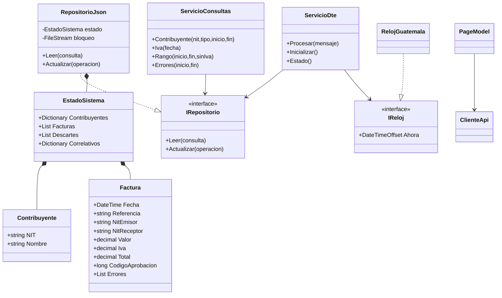
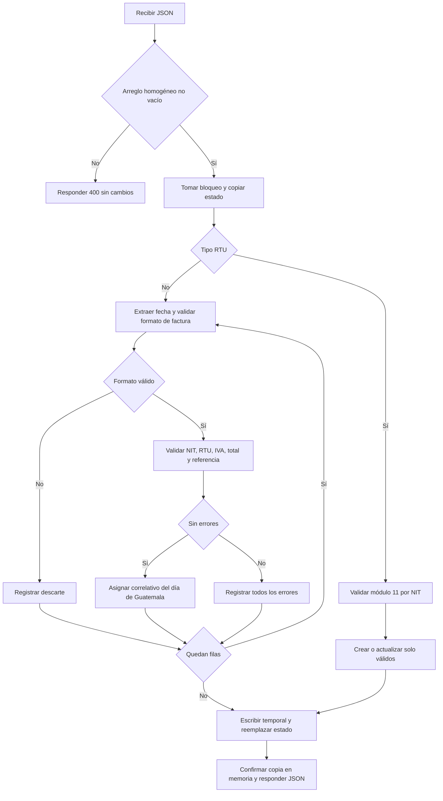
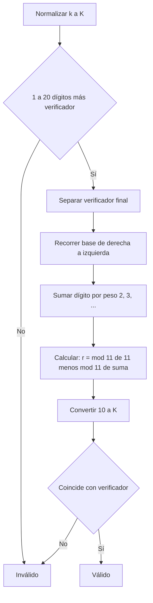
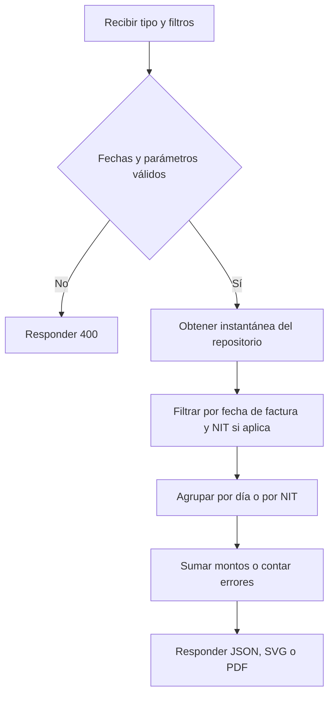
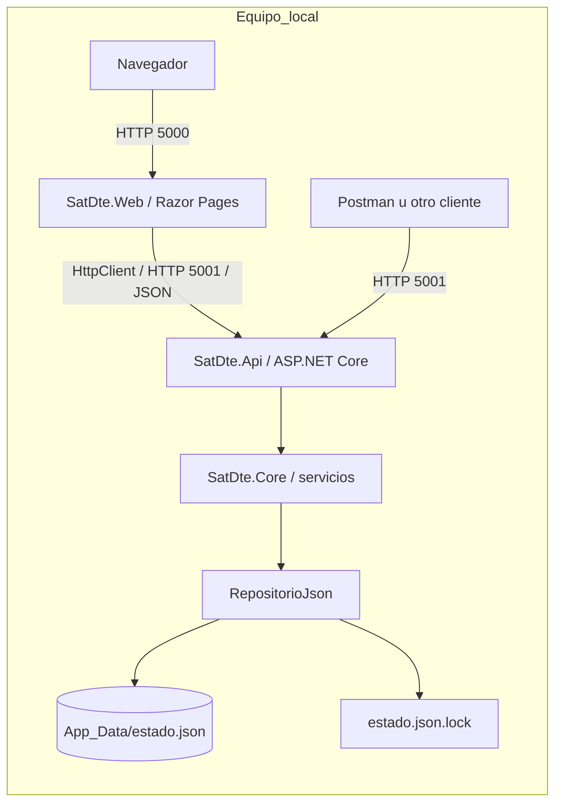

# Diagramas editables

Los diagramas también se incluyen dibujados en los anexos de Documentacion.pdf.

## Clases

## Actividad: procesar lote

## Actividad: NIT

## Actividad: consultas

## Despliegue

